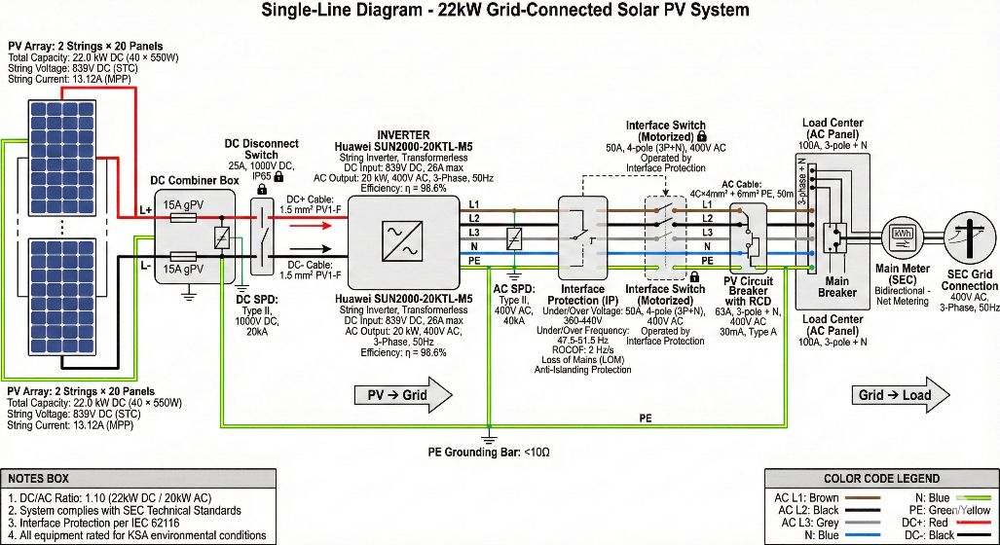
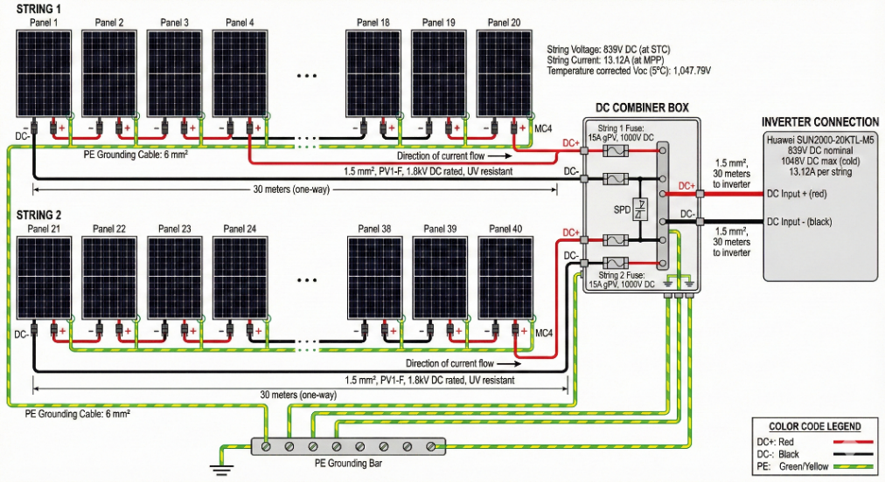
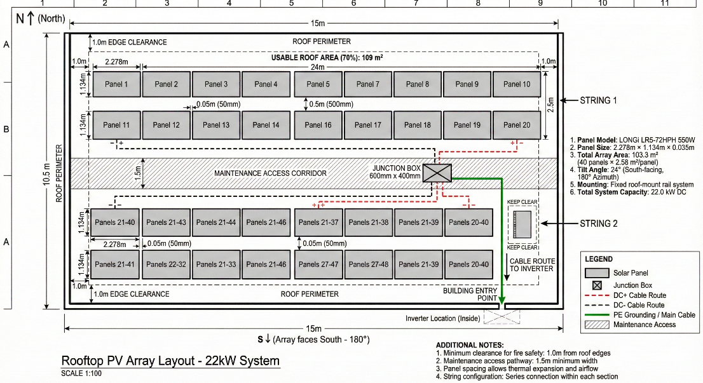

# 22 kW Grid-Connected Rooftop PV System: Residential Design (Riyadh)

> Renewable Energy Systems (EE 3758) term paper · design, sizing, standards compliance and economics

The complete design of a **grid-tied solar PV system** for a single-storey family house in Riyadh, Saudi Arabia, under the Saudi net-metering framework.

## Key figures
| | |
|---|---|
| **Array** | 40 × LONGi LR5-72HPH 550 W monocrystalline (PERC, half-cell) = **22.0 kW DC** |
| **Inverter** | Huawei 20 kW string inverter with dual MPPT |
| **Strings** | 2 strings × 20 panels into 2 MPPT inputs |
| **Tilt / azimuth** | 24° (about the site latitude), south-facing (180°) |
| **Solar resource** | 6.61 kWh/m²/day average (5.50-7.27 seasonal) |
| **Load** | 19.66 kW connected, 114.75 kWh/day, **41,884 kWh/year** (54 % air-conditioning) |
| **Annual yield** | **38,742 kWh/year** (NREL PVWatts), covering **92.5 %** of consumption |
| **System losses** | 14.08 % (derating factor 0.859) |
| **Investment** | SAR 128,740, with a payback of about 15.1 years and an NPV of SAR 46,858 over 25 years |
| **CO₂ avoided** | About **27.5 t/year** |

## Design drawings
### Single-line diagram

### String wiring

### Roof layout

The array covers 103.3 m² of the 109 m² usable roof area, with 1 m fire clearance at the edges and a 1.5 m maintenance corridor.

## What the paper covers
1. **Context:** Saudi solar potential, Vision 2030 and the National Renewable Energy Program (40 GW solar target), and the 2025 electricity tariffs
2. **Load assessment:** a room-by-room appliance schedule
3. **Sizing:** array size, string voltage and current limits against the inverter MPPT window, and temperature correction
4. **Cable sizing and protection:** DC/AC cables, fuses, SPDs, isolators and earthing, following **IEC 62548, IEC 60364 and SEC** standards, with IEC 62116 anti-islanding
5. **Performance simulation** in PVWatts
6. **Economic and environmental analysis:** cost, payback, NPV and CO₂ reduction

> Site-specific details (exact location and floor plan) are left out of this public repository on purpose.
